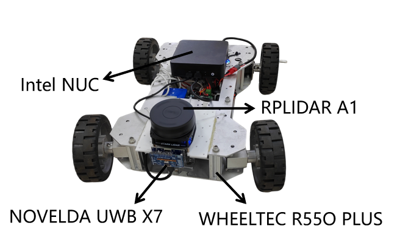
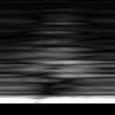
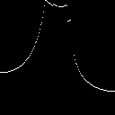

# Diffusion-Based Efficient Point-Cloud Enhancement for UWB Radar

This repository provides the processed dataset and implementation accompanying
the paper **Diffusion-Based Efficient Point-Cloud Enhancement for UWB Radar**.
It includes the EDM and consistency-distillation training code, fixed
eight-frame experiment configuration, point-cloud evaluation, latency
benchmarking, and deterministic post-beamforming preprocessing.

<p align="center">
  
</p>

## Dataset

The self-collected dataset contains 113,204 synchronized UWB radar--LiDAR pairs
from 13 indoor scenes. Twelve scenes (93,518 pairs) form the training domain.
The physically separate L2 scene (19,686 pairs) is reserved for final
generalization evaluation.

Each pair contains two 128 x 128, 8-bit grayscale PNGs on a common
range--azimuth grid:

```text
X7_A1_dataset/
  dataset_aligned_<scene>/
    radar/000000.png
    lidar/000000.png
```

The released scenes are `D7`, `G7`, `H`, `J2`, `K1`, `K5`, `L10`, `L1_S`,
`L6`, `T3`, `T5`, `T6`, and `L2`.

<table>
  <tr>
    <th>UWB range--azimuth input</th>
    <th>LiDAR target</th>
  </tr>
  <tr>
    <td></td>
    <td></td>
  </tr>
</table>

This example is `dataset_aligned_D7/000499.png`.

Download and verify the dataset:

```bash
wget https://github.com/dzhisu644-wq/diffusion-uwb-point-cloud-enhancement/releases/download/dataset-v1.0/X7_A1_dataset_v1.tar.zst
wget https://github.com/dzhisu644-wq/diffusion-uwb-point-cloud-enhancement/releases/download/dataset-v1.0/X7_A1_dataset_v1.tar.zst.sha256
sha256sum -c X7_A1_dataset_v1.tar.zst.sha256
tar -I zstd -xf X7_A1_dataset_v1.tar.zst
```

## Installation

Python 3.10 and an NVIDIA GPU are recommended.

```bash
python3 -m venv .venv
source .venv/bin/activate
python -m pip install --upgrade pip
python -m pip install -r requirements.txt
```

## Training

The published configuration uses eight input frames, FP32, batch size 32,
learning rate `5e-5`, 160k EDM updates, and 120k CD updates. It saves
checkpoints every 10k updates.

```bash
bash scripts/train_edm_frames.sh 8
bash scripts/train_cd_frames.sh 8
```

The commands use `config/paper_8f.env` and the fixed training manifest in
`config/paper_train.csv`. Environment variables can override paths and resource
settings, for example:

```bash
DATASET_DIR=/data/X7_A1_dataset \
RUNS_DIR=/data/runs \
EDM_MICROBATCH=8 \
bash scripts/train_edm_frames.sh 8
```

CD training expects the final EDM teacher at
`runs/edm_8f_full_v4/ema_0.9999_160000.pt`.

## Evaluation

Evaluate the final CD checkpoint on the physically separate L2 scene:

```bash
python scripts/evaluate_image_checkpoints.py \
  --training-bundle "$PWD" \
  --run-dir runs/cd_8f_full_v4 \
  --model-type cd \
  --frames 8 \
  --scenes L2 \
  --ema-rates 0.9999 \
  --updates 120000 \
  --common-history 9 \
  --batch-size 32 \
  --num-workers 2 \
  --metric-workers 2 \
  --sampler onestep \
  --sampling-steps 1 \
  --seed 0 \
  --evaluation-tag full
```

For EDM, use `--model-type edm`, `--updates 160000`, `--sampler heun`, and
`--sampling-steps 7`. A common history of nine preceding frames keeps the
eligible frame set identical in the 1/3/5/8/10-frame ablation. To reproduce the
training-domain fit, replace `--scenes L2` with
`--scenes D7,G7,H,J2,K1,K5,L10,L1_S,L6,T3,T5,T6`.

Benchmark batch-one latency with:

```bash
python scripts/benchmark_edm_frame_latency.py \
  --training-bundle "$PWD" \
  --model-type cd \
  --frames 8 \
  --update 120000 \
  --warmup 100 \
  --iterations 500
```

Pretrained checkpoints are not currently distributed.

## Preprocessing Scope

The public dataset starts from processed 128 x 128 RA and LiDAR rasters. Raw
UWB waveforms and proprietary SDK beamforming coefficients are not included.
The acquisition used one fixed SDK configuration with 37 beam directions from
-90 to 90 degrees at 5-degree intervals.
`preprocessing/beam_components_to_log_ra.py` and
`preprocessing/ra_log_to_png.py` reproduce the deterministic processing from
the SDK beam components to the released UWB PNGs.
`preprocessing/align_pairs.py` implements nearest-time pairing within 50 ms.

## License and Attribution

The diffusion implementation is adapted from
[Radar-Diffusion](https://github.com/ZJU-FAST-Lab/Radar-Diffusion) under the MIT
License. See `LICENSE` and `NOTICE.md`. Citation information for this work will
be added upon publication.
